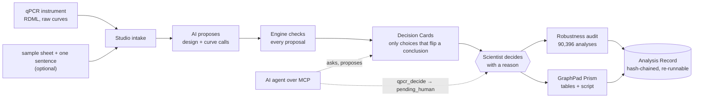

> [!NOTE]
> **Hackathon submission snapshot**
>
> This repository preserves the version submitted to **Reinvent the Wheel, 16–18 October 2026**, hosted by [Science Works](https://science.works) and [Inherent Laboratories](https://inherentlabs.ai/).
>
> **For the latest version, issues and contributions, visit the original project: [ShivaTeja05/Qpilot](https://github.com/ShivaTeja05/Qpilot).**
>
> Submitted version: [`7765f40`](https://github.com/science-works/rtw-2026-axi0n-qpilot/tree/7765f40355d86209226face948c522ccdb1e67bd). This notice was added after submission. Nothing else in the repository has changed.

---

<div align="center">

# qPilot

**Same qPCR data, different reasonable choices, different answers.<br>qPilot shows you which of your choices could change your conclusion, and records who decided.**

[](https://github.com/ShivaTeja05/Qpilot/actions/workflows/ci.yml)
[](LICENSE)


[Quickstart](#quickstart) · [How it works](#how-it-works) · [Commands](#commands) · [AI agents](#use-from-an-ai-agent) · [Validation](#validation) · [Docs](#documentation)


</div>

> **For research use only. Not for clinical or diagnostic use.**
> Built at *Reinvent the Wheel: A Tools for Science Hack* (London, 16–18 Oct 2026).

---

## Why qPilot

A qPCR result passes through many small choices before it becomes a sentence in a paper: which curves count as amplified, which control genes normalise the rest, how empty wells are treated, where the groups are cut. Each choice is reasonable. Together they can flip a conclusion, and today's tools hide them: the threshold is set per plate inside the vendor software, the ΔΔCt is done by hand in a spreadsheet, and nothing records what was chosen or why.

On the demo study, counting "Cq > 35" as *not detected* changes **10 of 58** conclusions, and the usual spreadsheet route changes **14 of 58**.

qPilot reads the instrument's **raw amplification curves**, analyses every plate with the same published method and settings, and runs **every reasonable analysis** of the same data. It then shows a person only the choices that can change a conclusion. The software decides only what changes no conclusion (with the other choices at their recommended settings), and writes every decision, with its reason and who made it, into a record that anyone can re-run.

<table>
<tr>
<td width="33%" valign="top">

### 🤖 The AI proposes
Fixed rules, an optional language model and the learned Curve Judge propose the study design and the curve calls. They never compute a number.

</td>
<td width="33%" valign="top">

### 🧮 The engine checks
Deterministic, validated statistics (LinRegPCR, geNorm, Welch's t-test) check every proposal and compute every number.

</td>
<td width="33%" valign="top">

### 🧑‍🔬 The scientist decides
A choice that can change a conclusion always waits for a person, whatever an agent or model says. This is enforced in code.

</td>
</tr>
</table>

## What you get

| | Component | What it does |
|---|---|---|
| 🧪 | **qPilot Studio** | A local page from the instrument export to GraphPad Prism: intake, a blind design check, curve calls, Decision Cards, the Prism draft and the round trip. [`docs/studio.md`](docs/studio.md) |
| 🔬 | **Robustness audit** | The Decision Simulator (`qsim`, in [`sim/`](sim/README.md)) re-runs the confirmed study under every combination of eight analysis decisions (**90,396 analyses** on the demo), gives each gene a verdict, and reproduces qPilot at the baseline. [`docs/integration.md`](docs/integration.md) |
| 🧾 | **Analysis Record** | One zip: input, results, every decision with its reason and who made it, and the audit bound to it. Hash-chained and checksummed, so anyone can verify and re-run it. |
| 🔌 | **One MCP server** | `qpilot serve`: 25 tools (20 `qpcr_*` and 5 read-only `sim_*`). An agent can ask and propose; it cannot overrule a person. [`docs/agents.md`](docs/agents.md) |
| 📊 | **Prism bridge** | log2 tables per biological unit, a Prism script (`run.pzc`) and provenance, plus a diff of what changed in Prism. [`docs/prism.md`](docs/prism.md) |
| 📐 | **Planner** | `qpilot plan`: before the first plate, the samples needed and what a design cannot detect. |

## Quickstart

Python 3.11 or newer. Times are wall-clock on a laptop with no model.

```bash
git clone https://github.com/ShivaTeja05/Qpilot && cd Qpilot
python3.11 -m venv .venv && source .venv/bin/activate
pip install -e '.[studio,sim]'                          # about 30 s
qpilot fetch-demo                                       # the 64-plate demo study, SHA-256 pinned (7 MB, once)
```

Then pick what you want to see:

```bash
# 1. Studio end to end, no browser: 28 checks, about 90 s
QPILOT_MODEL_PROVIDER=none qpilot studio demo --check

# 2. All 9 stages (Studio, audit, Prism, record, agents): 30 checks, 3–6 min
QPILOT_MODEL_PROVIDER=none python -m qpilot.integration demo --out demo-run

# 3. The audit's results screen on 127.0.0.1:8765 (Ctrl-C to stop)
qsim app --results demo-run/run/simulator_audit --no-model

# 4. The Studio page on 127.0.0.1 (Ctrl-C to stop)
qpilot studio

# 5. The 25 MCP tools this install serves
qpilot serve --list-tools
```

> [!NOTE]
> On macOS the first `qpilot` command after installing can take about 70 s (the first load of native libraries); later calls start in seconds. `--out` must be a new or empty folder.

> [!TIP]
> **The model is optional.** With `QPILOT_MODEL_PROVIDER=none` the fixed rules propose alone, and every demo number here comes from the rules. Typing the demo's 427 samples twice (854 items), the rules got 839/854 right; qwen2.5:7b 834/854; qwen2.5:14b and qwen2.5:32b 839/854. Safety held for every model: no control missed, nothing accepted without a person ([`docs/studio-measured.md`](docs/studio-measured.md)).

A 1 min 50 s recording of the one-page app is in [`demo/demo.mp4`](demo/demo.mp4).

## How it works



The integrated workflow runs nine stages on the same study, from intake to agents. Each stage says who proposes, what the engine computes, what a person decides and what is written:

| # | Stage | AI or rules propose | Engine computes or checks | Person decides |
|---|---|---|---|---|
| 1 | Intake | — | inspect the file; quarantine instruction-like names | drops in the file |
| 2 | Design, blind | design proposals | each one consistent or contradicted | accepts or rejects, with reasons |
| 3 | Curves, blind | Curve Judge | LinRegPCR checks each disagreement | keeps or overrides, confirms |
| 4 | Choices | — | 744 analyses; Decision Cards | decides each card |
| 5 | Audit | — | 90,396 analyses; baseline = qPilot | reads the verdicts |
| 6 | Prism | the draft | log2 per unit; provenance | Send to Prism |
| 7 | Round trip | — | what changed in Prism and what it changes | gives the reason, decides again |
| 8 | Record | — | export, verify, bind the audit | — |
| 9 | Agents | an agent asks over MCP | `qpcr_decide` → `pending_human` | answers in the app |

Full numbers for each stage, and the system diagrams: [`docs/integration.md`](docs/integration.md).

### The engine

All maths is ordinary, deterministic Python; no language model is involved. Steps, method cards and limitations: [`docs/engine.md`](docs/engine.md).

1. **Curves**: LinRegPCR, vendored unchanged from the RDML consortium's rdmlpython, on every plate ([method card](methods/linregpcr.md)).
2. **Control genes**: geNorm stability and the pairwise ratio check between the groups ([method card](methods/genorm.md)).
3. **Comparison**: Welch's t-test on log2 relative quantities, with a stated rule: *up or down only if p < 0.05 and the change is at least 2-fold; otherwise no call* ([method card](methods/contrast.md)).
4. **Robustness**: every reasonable analysis of the same plates (31 control-gene sets × 3 group cut-offs × 2 rules for empty wells on the demo: 186 analyses in `qpilot run` and the app; Studio adds four amplification-call rules, 744), and which choices flip which conclusions. The Decision Simulator's audit varies eight decisions (90,396 analyses on the demo).

### The one-page app

```bash
qpilot run --out results # numbers, robustness, confidence and Decision Cards (186 analyses of the demo)
qpilot app               # the one-page app on 127.0.0.1 (or: python -m qpilot.app)
```

**Analyse** opens the study. The left column shows the study summary and, for the four headline genes, how often each conclusion holds across every reasonable analysis, with a confidence verdict and its reasons (every gene is in the *All genes* table). The centre shows one **Decision Card** at a time, ranked by how many conclusions the choice can change. Pick an option, type a reason, **Decide**; the next card appears. **Export** writes the Analysis Record as one zip. For a clean demo run, `qpilot app --fresh-demo` moves earlier decisions aside (they are kept, never deleted).

## Commands

| Command | What it does |
|---|---|
| `qpilot fetch-demo` | Download the public 64-plate demo study (pinned, SHA-256 verified) |
| `qpilot studio` | qPilot Studio on 127.0.0.1; `qpilot studio demo --check` runs the walk-through without a browser |
| `qpilot run` | Analyse a study: results, robustness, confidence and Decision Cards |
| `qpilot app` | The one-page app on 127.0.0.1 (telemetry off, never shared) |
| `qpilot plan` | Before the first plate: samples needed and what a design cannot detect |
| `qpilot explain` | Print one explanation template rendered from a study's facts |
| `qpilot validate` | Reproduce the RDML consortium's published benchmark on the demo study |
| `qpilot doctor` | Versions, the dataset, the model provider and what can leave this machine (`outbound: none` without a model) |
| `qpilot serve` | The MCP server for AI agents, over stdio |
| `qpilot harness` | Score a model on your own study before trusting it (`make`, `run`, `show`) |
| `qpilot record` | Write the Analysis Record of a study, e.g. one decided in Studio |
| `qpilot verify` | Check a record's checksums, decision chain and proposal chain |
| `qpilot rerun` | Re-run a record and compare results byte for byte |
| `qpilot export` | `export prism`: tables and a Prism script for a study |
| `qpilot prism` | After Prism: `prism diff` shows what changed; `prism verify` checks a bundle |
| `qsim …` | The Decision Simulator: `demo`, `run`, `ask`, `whatif`, `validate`, `app` ([`sim/README.md`](sim/README.md)) |
| `python -m qpilot.integration` | The integrated workflow: `demo`, `audit --study <id>`, `verify` |

## Use from an AI agent

```bash
claude mcp add qpilot -- qpilot serve
```

`qpilot serve` is the one MCP server: qPilot's 20 `qpcr_*` tools and, when the Decision Simulator imports (it installs with this package), its 5 read-only `sim_*` tools over an audit. It reads and writes the same study store as the app.

An agent can read the study, ask what each choice would change, and request a decision:

```
run → qpcr_study → qpcr_robustness → qpcr_decide → pending_human → (scientist decides in the app) → record
```

A choice that can change a conclusion (with the other choices at their recommended settings) becomes a request that waits for a person, whatever the agent says; that check is made once, when the study is analysed. Every MCP caller is recorded as an agent, and `actor="human"` is refused. No tool can accept, edit or reject a Studio proposal.

> [!IMPORTANT]
> The gate binds agents whose only access to qPilot is MCP (or the in-app model). An agent that can run commands as you can still act as you. Give agents MCP access, not your shell.

The full guide, including models inside qPilot (`QPILOT_MODEL_PROVIDER` = `none`, `anthropic` or `openai_compatible`) and how to test a model before trusting it with the harness, is [`docs/agents.md`](docs/agents.md).

## Validation

`qpilot validate` compares the engine with the RDML consortium's own published results for the demo study's dilution standards (tables fetched SHA-256-pinned). Generated lines, exactly as `qpilot validate` prints them from the numbers in `validation/validation.json`:

- N0 on 930 standard wells (62 genes) vs RDML-Tools: 99.6 % identical to 4 significant figures, 100.0 % within 5 % (largest difference 0.05 %)
- Dilution-series bias over 62 genes vs LinRegPCR (2013): median |difference| 0.021 (ours 0.961 vs published 0.947 on average)
- Cq on 945 standard wells (63 genes) vs LinRegPCR (2013): offset +0.97 cycles on average (SD 0.17), a change in how LinRegPCR defines Cq, disclosed

Full table and sources: [`validation/validation_table.md`](validation/validation_table.md). The Decision Simulator adds known-answer tests against digital PCR on four qPCR machines, planted faults in real data, and no-difference tests ([`sim/README.md`](sim/README.md)).

## The Analysis Record

Export writes one zip: the input RDML (byte for byte, when the original file is still on disk; the export message says so), the results, the cards, the robustness grid (`grid.csv`), the facts every sentence cites, the design, every decision with its reason and who made it (`human`, `agent` or `system`), the software versions and the vendored method's commit, and a `CHECKSUMS.sha256`.

```bash
qpilot record --study <id> --out rec      # the record of a study decided in Studio (the id the page shows)
qpilot verify qpilot-record-<study>.zip   # checksums and the decision chain
qpilot rerun <unzipped record folder>     # re-runs the analysis from the record's input; compares results.json
```

The re-run reproduces the results at the recommended choices (a decision is recorded with its reason; it does not change `results.json`; each option's consequences are in `cards.json` and `grid.csv`). It reuses the local curve cache; set `QPILOT_CACHE_DIR` to an empty folder to re-fit every curve.

<details>
<summary><b>How tamper-evident is it?</b></summary>

Decisions are a hash chain: each entry carries the hash of the one before, so an entry edited or removed without recomputing the hashes is detected (a removed last entry through `CHECKSUMS.sha256`). Nothing is signed: someone who recomputes every hash is not detected unless the record id is compared with a copy kept elsewhere. That makes the record tamper-evident against accidental or naive edits, not tamper-proof; it is not a 21 CFR Part 11 system.

</details>

## Where to look, and what the data cannot show

```bash
qpilot trace --gene CAMTA2            # from a result back to the wells to look at (reads only)
qpilot trace --well HMBS_20080318:K22 # does this one well matter?
qpilot evidence                       # what this study cannot tell you (Evidence Ledger)
qpilot report run-review --out review.html
qpilot check sheet analysis.xlsx      # recompute your own ΔΔCq sheet; the file is never edited
qpilot plan --sd 0.5 --sd-rt 0.4 --sd-well 0.3 --n 6   # biological, RT and technical replicates together
qpilot instrument inspect run.eds     # what the run file says about the instrument
qpilot export excel --out results.xlsx  # results plus a "Where to look" sheet
```

- **Trace** walks from a gene's conclusion, a sample or a well back through the normaliser, the reference wells and the plate controls. It stops at a plate and well, and says what each one does to the conclusion. On the demo, CAMTA2's first place to look is tumour 2016 on plate HMBS_20080318, well K22: one HMBS well reads Cq 46.1 while the tumour's other four reference wells read normally. Reading that well from the other four changes CAMTA2 from no call to down. A trace that would change a call opens a decision only a person can take. Method: [methods/trace.md](methods/trace.md).
- **Evidence Ledger** lists the controls and annotations a study has and lacks: NTCs, no-RT, reference-gene stability, efficiency source, RNA integrity, RT replicates, biological units, inter-run calibrators, lots, instrument dates. Absent items never change a conclusion. Method: [methods/evidence.md](methods/evidence.md).
- **Spreadsheet Check** recomputes a lab's own analysis sheet from its Cq values. It names the first column that differs and the known slip that reproduces it, such as an inverted sign, the exponent applied twice, or statistics run on fold changes. Tested on generated sheets only so far. Method: [methods/sheetcheck.md](methods/sheetcheck.md).
- **Instrument Logbook** reads calibration dates, run state and log events from QuantStudio `.eds` and export headers. It keeps a hash-chained logbook per instrument, with events inferred from successive files and incidents a person confirms. Lookback answers "which of my conclusions used this period?". The formats are tested on synthetic files built to the layouts seen in public files; several are unverified (see [methods/instrument_context.md](methods/instrument_context.md) and [methods/lookback.md](methods/lookback.md)).

## Will it work in my lab?

| | |
|---|---|
| RDML export from the instrument | ◐ RDML 1.3 and 1.4 tested; 1.0–1.2 are migrated by the vendored code but untested |
| QuantStudio `.eds` | ◐ export to RDML with Thermo's own tools first for the analysis (not tested here); `qpilot instrument inspect` reads the file's calibration dates, run state and log events (synthetic test files only) |
| QuantStudio TXT, other native formats | ✘ roadmap |
| Offline on a laptop, no account | ✔ (macOS: full analysis tested with the network off; Linux: unit tests in CI, without the demo study; Windows untested) |
| Reproduces my lab's numbers | ◐ reproduces the published benchmark above; your own instrument is untested |
| Results as CSV | ◐ the robustness grid (`grid.csv`); `qpilot export excel` writes results with a "Where to look" sheet; a per-gene CSV is on the roadmap |
| Prism export | ◐ `qpilot export prism` / Studio's Send to Prism write log2 tables per biological unit, a Prism script (`run.pzc`) and provenance (Mode S: Prism itself reads and writes its files). **Not yet run in a real Prism**: the script commands follow GraphPad's documentation, the templates must be made once by hand, see [docs/prism.md](docs/prism.md). Not affiliated with GraphPad Software or Dotmatics |
| Results written back into RDML | ✘ roadmap |
| Hash-chained record of every decision | ✔ (tamper-evident; not Part 11) |
| My own study design | ✔ `qpilot run --design study.yaml --samples sheet.csv`, or in qPilot Studio, where the AI proposes the design from your file, sheet and one sentence and you confirm each item; the demo is one preset (tested on synthetic designs and on the demo re-entered as two named groups, which reproduces it exactly) |
| Technical replicates | ✔ averaged per biological unit (mean of log2 quantities); never counted as n; a group with fewer than two biological units gets no p-value |
| Which curves count as amplified | ✔ LinRegPCR by default; "Cq ≤ 40 / 38 / 35" are shown as choices with their consequences (on the demo, "Cq > 35 = not detected" changes 10 of 58 conclusions); the learned Curve Judge is a second opinion whose disagreements a person resolves (validated on the demo's LightCycler 480 SYBR only) |

## Demo dataset

Vermeulen J *et al.* (2009) *Lancet Oncology* 10:663–671 and Ruijter JM *et al.* (2013) *Methods* 59:32–46; CC BY 4.0 (the licence of the CRAN `vermeulen` and `ruijter` packages that redistribute the data). qPilot downloads the copy in the RDML consortium's rdmlpython repository at a pinned commit.

**64 plates** (one gene per plate) · **366 neuroblastoma tumours** · **24,576 reactions** · **5 candidate control genes**. The demo groups are **MYCN-high (the top 15 % by MYCN expression) versus the rest**: expression-defined, not the clinical MYCN amplification call.

## Limitations

- The one-page app (`qpilot app`) is set up for the demo study's design: the study must contain the marker gene `MYCN(4)` and the demo's candidate control genes. Your own design goes through Studio, or `qpilot run --design study.yaml --samples sheet.csv`; `qpilot plan` sizes a design before the first plate.
- One gene per plate in the demo, so plate effects cannot be separated from gene effects; no mixed model.
- Technical replicates are averaged per biological unit in a confirmed design; the robustness audit needs one well per sample and gene, so it does not run on such a design yet. In the demo each tumour has one well per gene; only standards and controls are in triplicate. No melt-curve analysis; no kinetic outlier test.
- Curve analysis (N0, Cq, dilution bias) is validated against published results on the standards of one study from one instrument platform (LightCycler 480, SYBR Green I). The later steps (geNorm, the contrast, robustness) are tested against reproduced numbers, not a published benchmark.
- No correction for testing many genes: the robustness check measures sensitivity to analysis choices, not significance.
- Results are not yet written back into the RDML file (roadmap).

## Security and privacy

- The app binds to `127.0.0.1` only, is never shared, refuses requests for any other host name, and turns telemetry off before the UI library loads.
- It serves files only from a private export folder and Gradio's own upload folder; the study store and the dataset cache are blocked.
- The whole analysis runs with the network switched off (`tests/core/test_offline.py`).
- RDML files are parsed without external entities or network access and with size caps.
- A model sees facts, never raw curves; it may write numbers only as fact tokens, and a validator rejects any other digit. Text in a file that reads like an instruction is quoted, marked and never obeyed. A remote model sees sample names only as pseudonyms.

Threats and mitigations: [`THREAT_MODEL.md`](THREAT_MODEL.md). Reporting a vulnerability: [`SECURITY.md`](SECURITY.md).

## Repository layout

```
qpilot/
├── io/, qpcr/, vendor/     RDML loading, the qPCR engine, LinRegPCR vendored unchanged
├── core/                   robustness grid, Decision Cards, the human gate, facts, store, record
├── ai/                     model client, Design Interpreter, Prism draft, number validator
├── harness/                scores a model on your own study before you trust it
├── prism/                  the GraphPad Prism bridge (tables, script, round trip)
├── integration/            the nine-stage workflow and the sim_* MCP tools
├── studio.py, app.py       qPilot Studio and the one-page app
├── mcp_server.py           qpilot serve
└── cli/                    the command line (qpilot …)
sim/                        the Decision Simulator (qsim): robustness audit and results screen
methods/                    method cards: LinRegPCR, geNorm, the contrast
validation/                 the published benchmark and its generated table
docs/                       Studio, engine, agents, integration, Prism, measured model runs
training/                   the Curve Judge's training code
tests/                      unit, integration and demo-data tests
```

## Documentation

| Guide | Read it for |
|---|---|
| [`docs/studio.md`](docs/studio.md) | qPilot Studio, step by step |
| [`docs/engine.md`](docs/engine.md) | the engine's steps, method cards and limits |
| [`docs/integration.md`](docs/integration.md) | the nine-stage workflow, its numbers and diagrams |
| [`docs/agents.md`](docs/agents.md) | MCP tools, models inside qPilot, the harness |
| [`docs/prism.md`](docs/prism.md) | the Prism bridge and its round trip |
| [`docs/studio-measured.md`](docs/studio-measured.md) | measured model runs, 7B to 32B |
| [`sim/README.md`](sim/README.md) | the Decision Simulator and its results screen |
| [`THREAT_MODEL.md`](THREAT_MODEL.md) | threats and mitigations |

## Development

```bash
pip install -e '.[dev,ai,studio,sim]'
ruff format --check . && ruff check .
pytest -q -m "not demo_data"      # what CI runs (Python 3.12)
pytest -q                         # everything, after qpilot fetch-demo
```

CI runs lint, the unit tests and `pip-audit` on every pull request. Contributions: [`CONTRIBUTING.md`](CONTRIBUTING.md).

## Built and borrowed

**Borrowed, credited, unchanged:** LinRegPCR (rdmlpython, MIT, vendored at `fce7a44`); the RDML format and schemas; the geNorm method (Vandesompele *et al.* 2002, reimplemented from the paper); SciPy's t distribution; the demo data and the published benchmark tables.

**Built here:** the hardened RDML loader and pinned downloads; the per-plate curve table; quantities, groups, geNorm, the contrast and its rule; the reference-gene group check; the decision space and robustness grid; Decision Cards and the escalation rule; the on-disk study store; the Analysis Record and its hash chain; confidence grades; templated explanations whose numbers are all facts; the one-page app; qPilot Studio and the Prism bridge; the Decision Simulator (`sim/`) and the integrated workflow (`qpilot/integration/`); the MCP server; the model layer and its test harness; `qpilot plan`; the validation script.

## Related tools and cost

- **Clarida** ([clarida.bio](https://clarida.bio)), from the authors of geNorm, qbase+ and the MIQE guidelines: analysis from Cq values with geNorm, a MIQE compliance score and methods text. qPilot uses their method and starts one step earlier, from the raw curves.
- **LinRegPCR web / RDML-Tools** ([rdml.org](https://www.rdml.org)): the reference curve-analysis method, file by file, which qPilot ships unchanged and runs on every plate of a study.
- **AnnealIQ**: a conversational qPCR analysis assistant (closed beta) working from Ct values.

For the analysis-and-statistics step, Clarida's Lab plan is listed at €4,800–9,600 a year ([clarida.bio/pricing](https://clarida.bio/pricing); academic pricing is lower and not listed), and GraphPad Prism at $260–520 per seat a year ([graphpad.com/how-to-buy](https://www.graphpad.com/how-to-buy)). qPilot is Apache-2.0 and runs on a laptop. It does not replace the instrument's own software, validated (Part 11) editions, or Prism for non-qPCR work.

## Roadmap (not built)

- QuantStudio TXT and other native importers
- Results written back into RDML, and a per-gene CSV
- The Prism export run in a real Prism
- The robustness audit on designs with technical replicates
- A simulator panel on the Studio page
- Replicate-outlier and melt-peak cards on data that has them
- A mixed model with plate as a random effect, once a gene spans two or more plates
- NormFinder, reimplemented from the paper

## Licence and citation

qPilot is Apache-2.0 ([`LICENSE`](LICENSE)). Third-party licences, data and the generated package list are in [`THIRD_PARTY_NOTICES.md`](THIRD_PARTY_NOTICES.md); a CycloneDX bill of materials can be generated with `cyclonedx-py environment -o sbom.json` (not committed; it will be attached to tagged releases, none yet). To cite qPilot and the methods it builds on, see [`CITATION.cff`](CITATION.cff).
